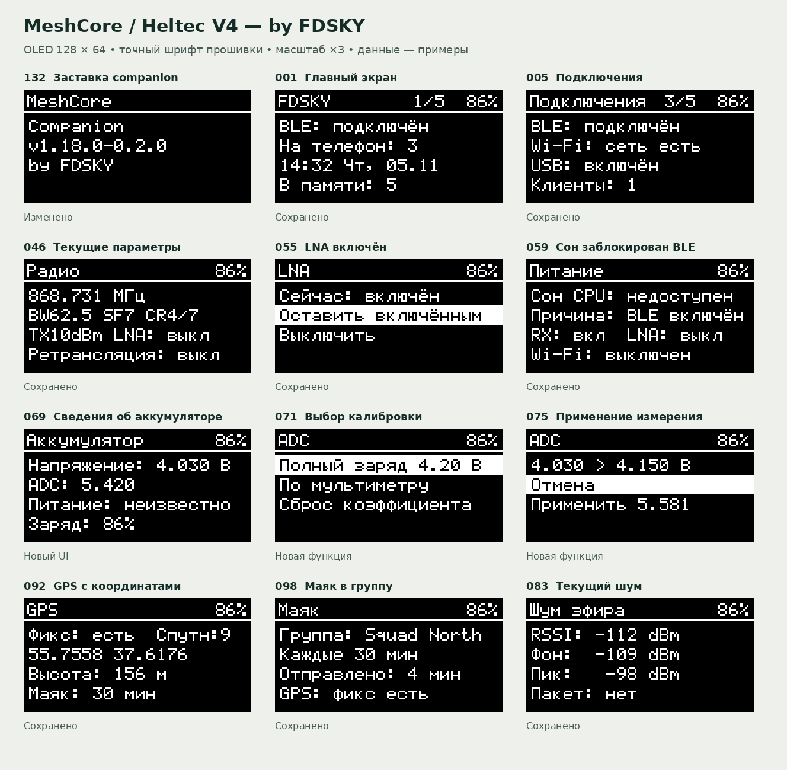

# Heltec V4 companion — проект OLED 128×64

**140 макетов состояний**, сгруппированных по функциям. Это спецификация для разработки, а не фотографии работающей прошивки. Значения частоты, напряжения, времени, имени и координат на изображениях — примеры; прошивка должна брать их из текущих настроек и датчиков.

Откройте [галерею](index.html) для поиска по всем экранам, [каталог](SCREEN_CATALOG.md) для текста и действий, [инструкцию реализации](IMPLEMENTATION_GUIDE.md) для разработчика или [разбор функций](UX_REVIEW.md) для подробного обоснования. Для скачивания всего набора используйте [ZIP ветки GitHub](https://github.com/ferrisaxis/MeshCore/archive/refs/heads/docs/heltec-v4-fdsky-ui.zip). Крупные PNG 512×256 доступны по одному в [screens](screens/); исходные 128×64 встроены в автономную HTML-галерею, контактные листы — в [sheets](sheets/). [screens.json](screens.json) содержит номера, состояния, строки и действия.

## Решение по нижней строке

Постоянная подсказка вроде «Держать: открыть» убрана со всех макетов. Заголовок занимает y=0…12, содержимое — до четырёх строк с шагом 11 px, начиная с y=17. Нижняя строка (y≈50) теперь доступна для данных, например фактического repeat, RX Boost, состояния LNA, клиента или заряда. Если четвёртого значения нет, экран остаётся свободным, без декоративного текста. Жесты описаны в инструкции и показываются на дисплее только при первом знакомстве или когда действие неочевидно.

На экранах подтверждения остаются явные «Отмена» и «Применить»; отмена выбрана по умолчанию. На экранах ошибки место используется для причины и результата. Индикатор батареи — текстовый процент без значка.

## Область работ

Экраны 001–135 относятся к companion; 136–140 показывают **отдельную будущую сборку репитера** и не являются переключением роли в companion. Пункты со статусом «Новый UI» или «Новая функция» требуют реализации; даже «Сохранено» означает сохранение возможности, а не готовность показанного рисунка в прошивке. На 6 ноября 2026 код ADC, процентов и базовой навигации уже в `main`; подробные макеты меню и четвёртая строка остаются заданием для следующей реализации. История: [ADC и процент](https://github.com/ferrisaxis/MeshCore/pull/1) и [навигация OLED](https://github.com/ferrisaxis/MeshCore/pull/2).
