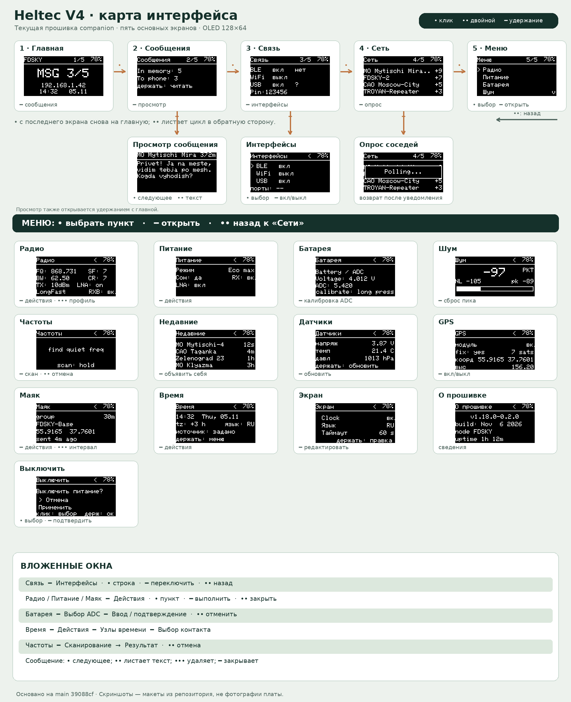
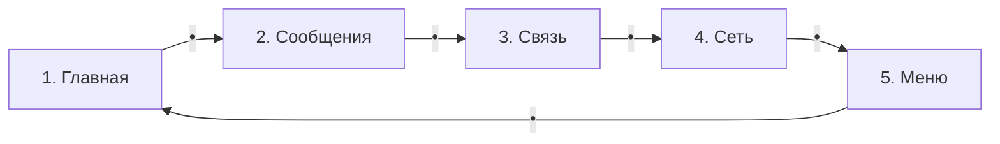
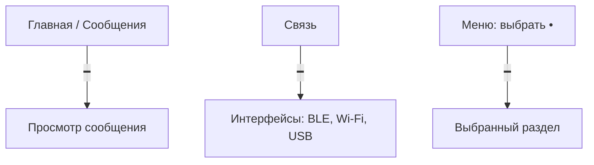
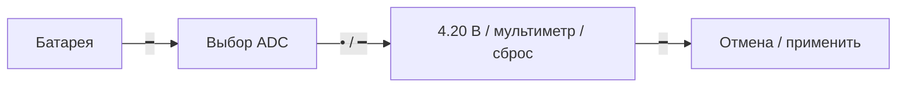
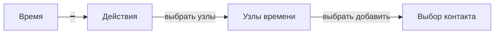

# Карта экранов Heltec V4 companion

Карта основана на `main` `39088cf` (6 ноября 2026). Миниатюры взяты из `docs/ui-mockups/ru` и показывают демонстрационные значения. Это **текущая логика прошивки**, включая отмеченные ниже шероховатости, а не схема уже согласованного редизайна. Репитер здесь отсутствует.

## Обозначения

| Жест | Смысл в общей навигации |
|---|---|
| `•` | Один клик: следующий корневой экран или следующий пункт списка |
| `••` | Двойной клик: предыдущий корневой экран либо выход из обычного подэкрана |
| `━` | Удержание около 1 с: открыть выбранное / выполнить действие |
| `•••` | Тройной клик: контекстное действие (на радио быстро меняет профиль) |
| `••••` | Четверной клик: остановить маяк |

Эти символы служат **легендой схемы**. На самом OLED точки и полосу надо рисовать примитивами, а не печатать Unicode. Первый завершённый жест при погашенном дисплее только пробуждает его. Удержание в первые 8 секунд загрузки вызывает CLI rescue.

## Пять основных экранов

`••` идёт по этому циклу в обратную сторону. На главной и «Сообщениях» удержание открывает просмотр сохранённых сообщений (если они есть). На «Связи» удержание открывает «Интерфейсы», на «Сети» отправляет опрос соседей. В «Меню» один клик перемещает маркер, удержание открывает выбранный раздел.

## Прямые подэкраны

| Где | Жест внутри | Что происходит |
|---|---|---|
| Просмотр сообщения | `•` | Следующее сообщение; последнее закрывает просмотр |
| Просмотр сообщения | `••` | Следующая страница длинного текста, **не возврат** |
| Просмотр сообщения | `•••` / `━` | Убрать текущее из просмотра / закрыть просмотр |
| Интерфейсы | `•` / `━` / `••` | Следующая строка / переключить выбранный интерфейс / назад на «Связь» |

## Разделы меню

В списке 13 пунктов, одновременно видны четыре; они прокручиваются одним кликом. Удержание открывает выделенный экран, двойной клик с обычного подэкрана возвращает в корневое «Меню».

| Пункт | Удержание в разделе | Другие жесты |
|---|---|---|
| Радио | Меню: следующий профиль, RX Boost, LNA (если управляемый FEM) | `•••` немедленно применяет следующий профиль |
| Питание | Меню: следующий / предыдущий режим | Режим применяется сразу после выбора действия |
| Батарея | Открыть калибровку ADC | Внутри: `•` выбор, `━` продолжить, `••` отменить/назад |
| Шум | Сбросить пик | RSSI, NL и пик обновляются автоматически |
| Частоты | Начать сканирование | `••` отменяет скан и возвращает радио на исходную частоту |
| Недавние | Отправить advert | Всплывает результат отправки |
| Датчики | Прочитать сейчас | Строки датчиков прокручиваются автоматически |
| GPS | Переключить модуль | Состояние fix, спутников, позиции зависит от реального GPS |
| Маяк | Меню: режим, интервал, остановка | `•••` интервал; `••••` остановка |
| Время | Меню: запрос времени / узлы времени | Внутри узлов — ещё уровень выбора контакта |
| Экран | Войти в редактирование | В редакторе `•` строка, `•••` значение, `━` выход |
| О прошивке | Нет действия | Версия, сборка, имя, время работы |
| Выключить | `━` на «Отмена» закрывает диалог; на «Применить» выключает | `•` выбирает; «Отмена» предвыбрана |

Наличие управляемого LNA определяется платой; отсутствие FEM не убирает встроенный RX Boost. GPS и датчики зависят от сборки/оборудования. Маяк включён в список при флаге GPS-сборки, даже если сам GPS сейчас выключен.

## Более глубокие цепочки

Радио, питание и маяк используют одинаковое меню действий: `━` открывает список, `•` двигает маркер, `━` выполняет, `••` закрывает. Часть действий меняет параметры сразу, без предпросмотра.

**Сейчас есть два исключения, которые нужно исправить:** двойной клик внутри «Выбора контакта» листает контакты назад и вообще не выходит из этого экрана; из «Узлов времени» он перескакивает в корневое «Меню». Тройной клик на радио обходит даже открытый список действий и применяет профиль. Полный разбор — [аудит интерфейса](https://github.com/ferrisaxis/MeshCore/pull/4). После исправления вложенная цепочка должна возвращаться по одному уровню, а открытое меню — поглощать все жесты кроме своих.
