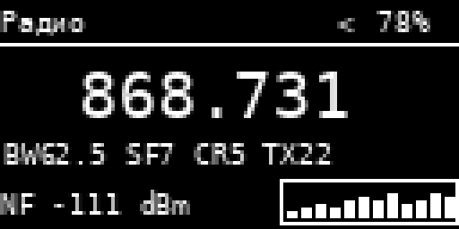
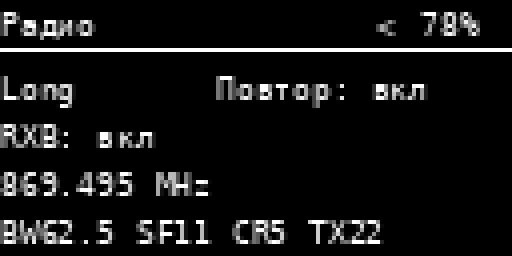
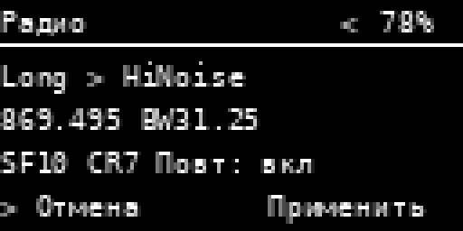

# Heltec V4 companion: первый проход по интерфейсу

Экран OLED 128×64, одна кнопка. Изменения относятся к `ui-new` компаньона. Репитер не затронут. Изображения ниже — иллюстрации компоновки с демонстрационными значениями, не снимки с платы.

## Радио

| Обзор | Состояние | Смена профиля |
|---|---|---|
|  |  |  |

На экране «Радио» один клик переключает обзор и состояние, двойной возвращает в «Меню», удержание открывает действия. Частота крупная; под ней BW/SF/CR/TX, NF и история последних двенадцати уже имеющихся оценок шума. Обновление каждые две секунды не запускает сканирование и не перестраивает радиочастоту. Пока оценка неизвестна, написано `NF --`. На втором состоянии видны текущий профиль, факт разрешённого repeat, RX Boost и управляемый FEM LNA, если плата его поддерживает.

В списке действий радиопрофиль теперь показывает предстоящие частоту, BW/SF/CR и repeat. По умолчанию выбрана «Отмена». Один клик выбирает «Применить», удержание подтверждает; двойной отменяет. Тройной клик открывает список действий, но не переключает профиль в обход подтверждения. TX при смене профиля не изменяется и показан в обзоре и состоянии, а не в подтверждении.

## Другие переходы

- Вложенные «Время → Узлы времени → Выбор узла» возвращаются двойным кликом по одному уровню. Пустой список контактов тоже можно закрыть.
- Когда открыт список действий, он принимает жесты первым: один клик перемещает выбор, двойной закрывает, удержание выполняет. Тройной и четверной клики не изменяют параметры за списком.
- В редакторе экрана двойной клик завершает редактирование, следующий двойной возвращает в меню. Тройной меняет выбранное значение.
- Выделенный пункт меню и строка действия инвертированы. Однотипные нижние подсказки убраны там, где они занимали строку без новых данных; в редакторе ADC подсказка остаётся.
- Строки пустых объявлений, соседей, поиска частоты и напряжения батареи переводятся вместе с языком UI. Названия вариантов ADC обновляются после переключения RU/EN. Координаты GPS не показываются при отсутствии текущего fix.

## Проверка на плате

Сборка CI для `heltec_v4_oled_companion_usb_ble_wifi` включена в PR. После сборки проверить оба состояния радио, отмену и применение профиля, возврат из узлов времени, список действий при тройном клике, RU/EN на батарее, график NF и видимость строк при 100% и `--%` батареи. Компиляция и иллюстрации не заменяют проверку реального OLED и радиосвязи.
