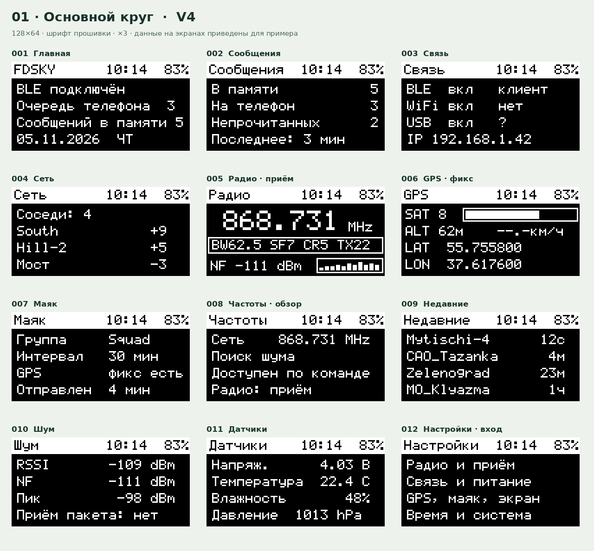
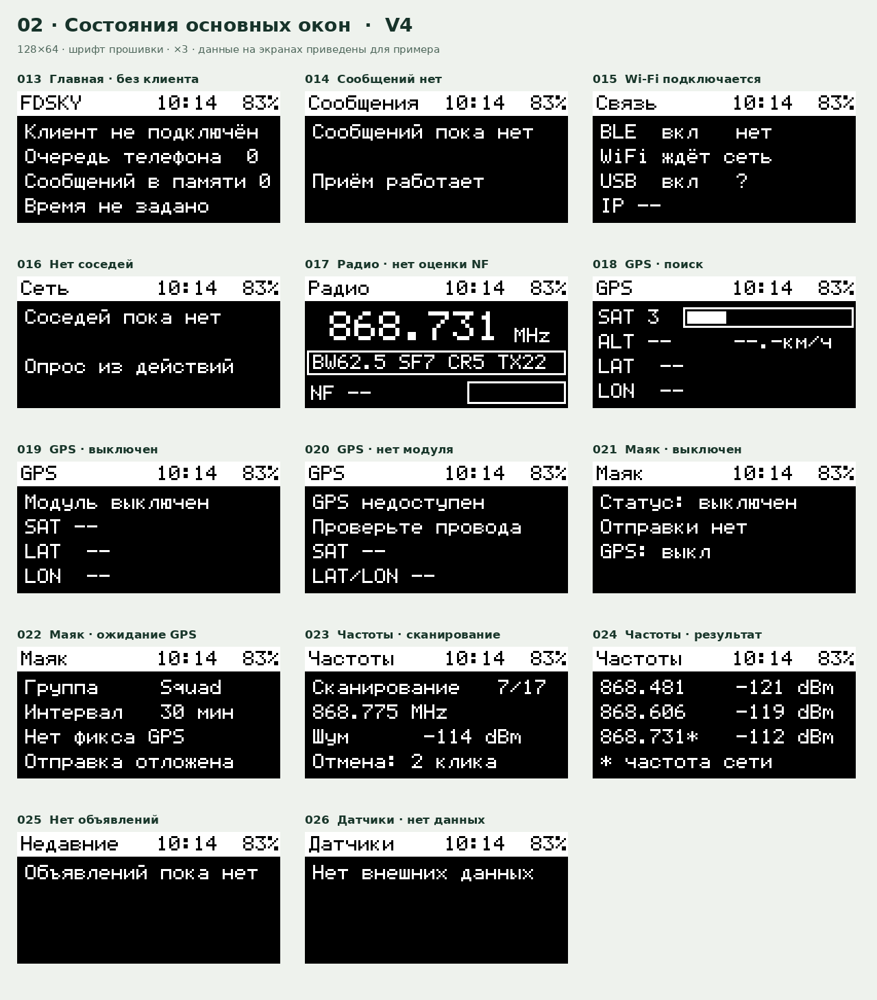
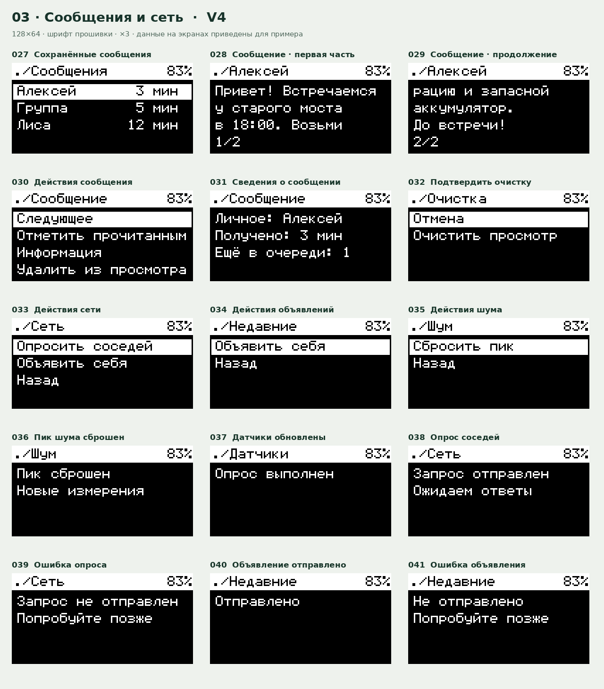
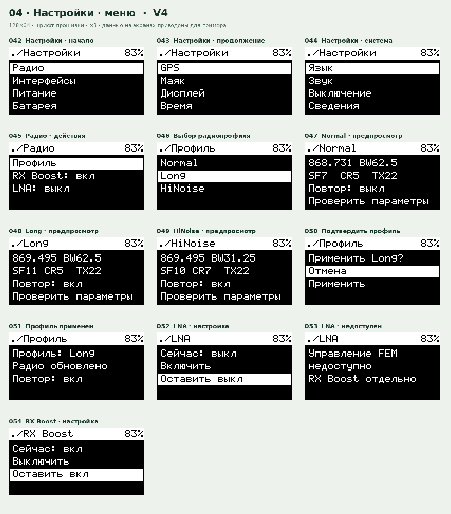
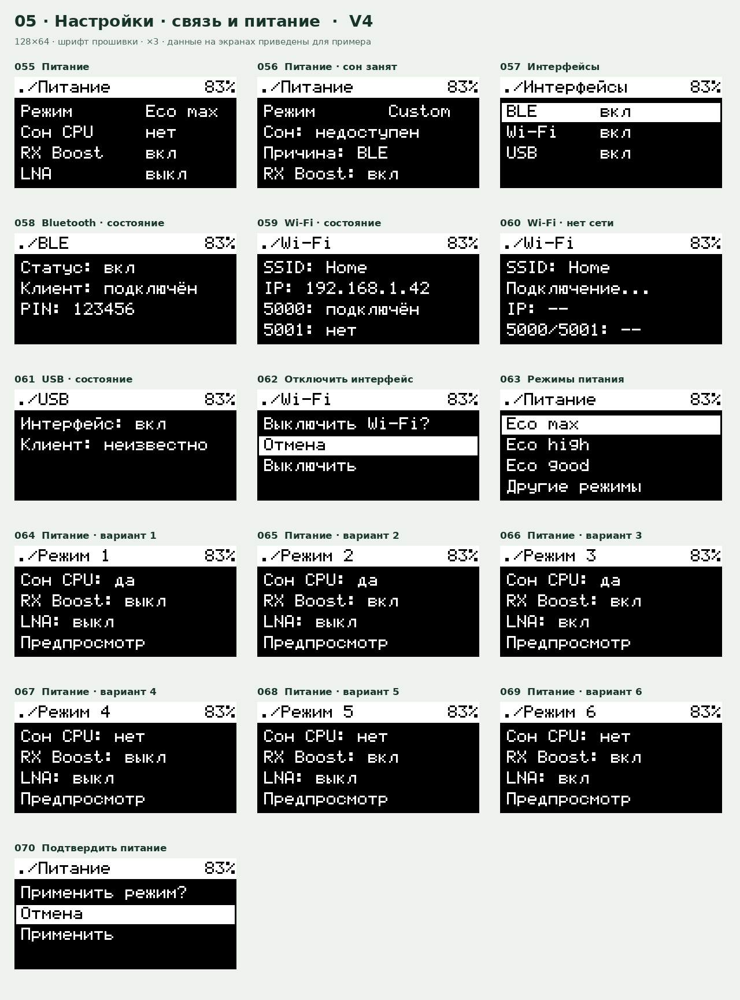
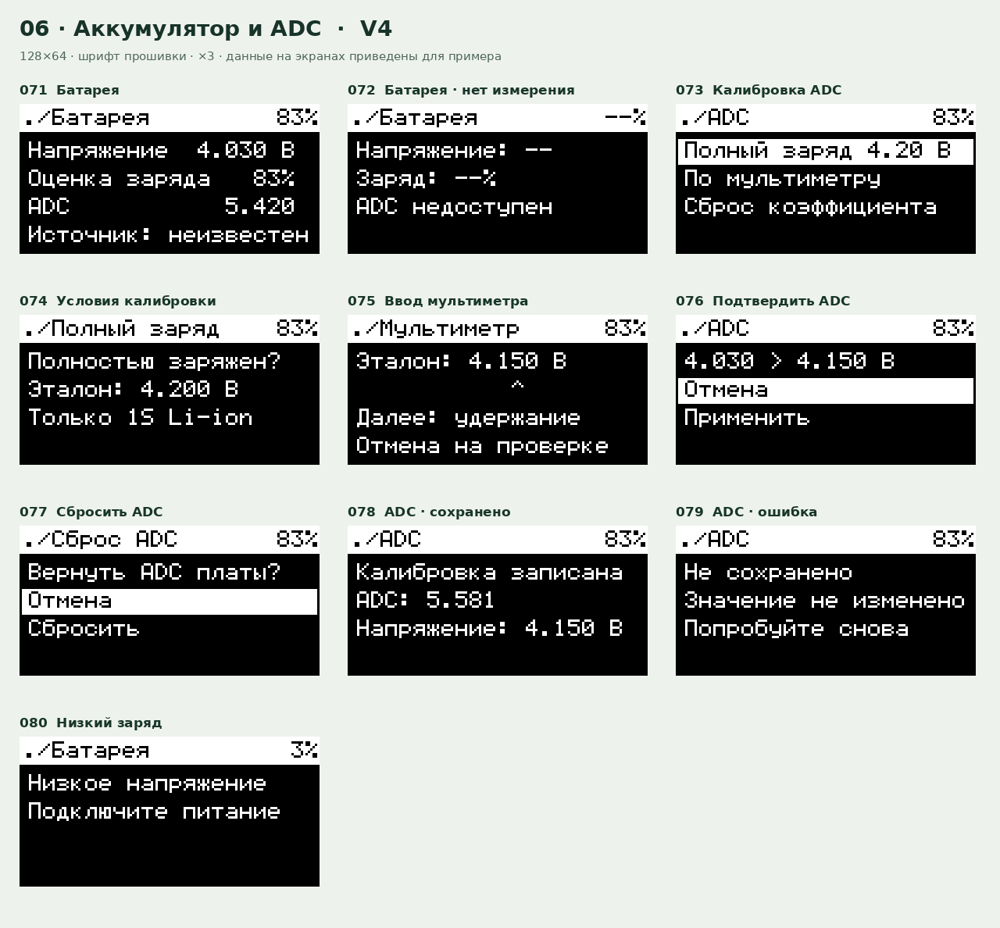
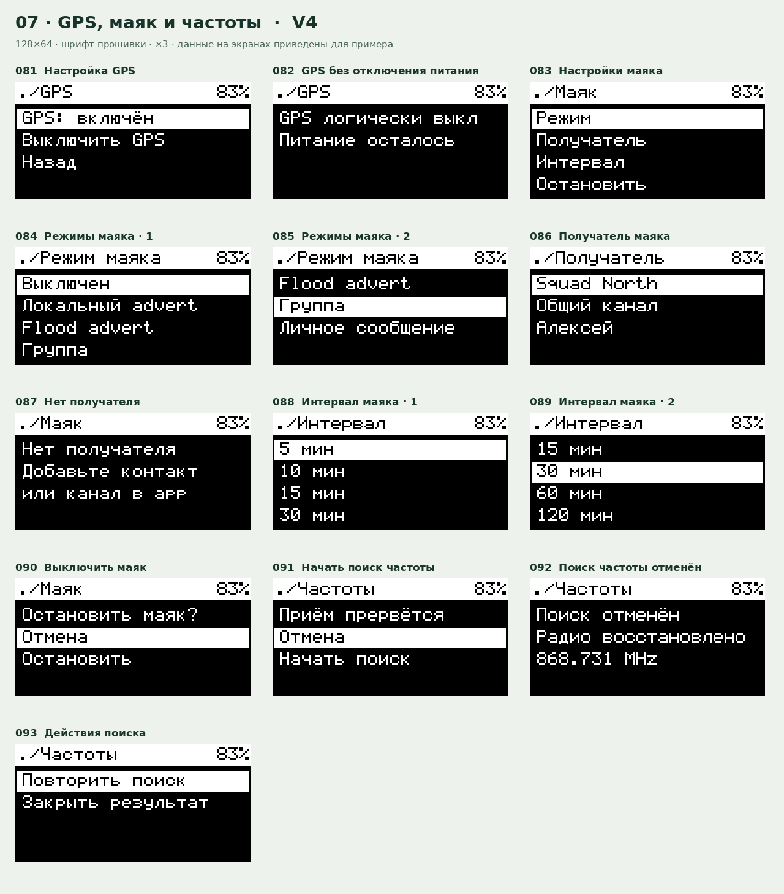
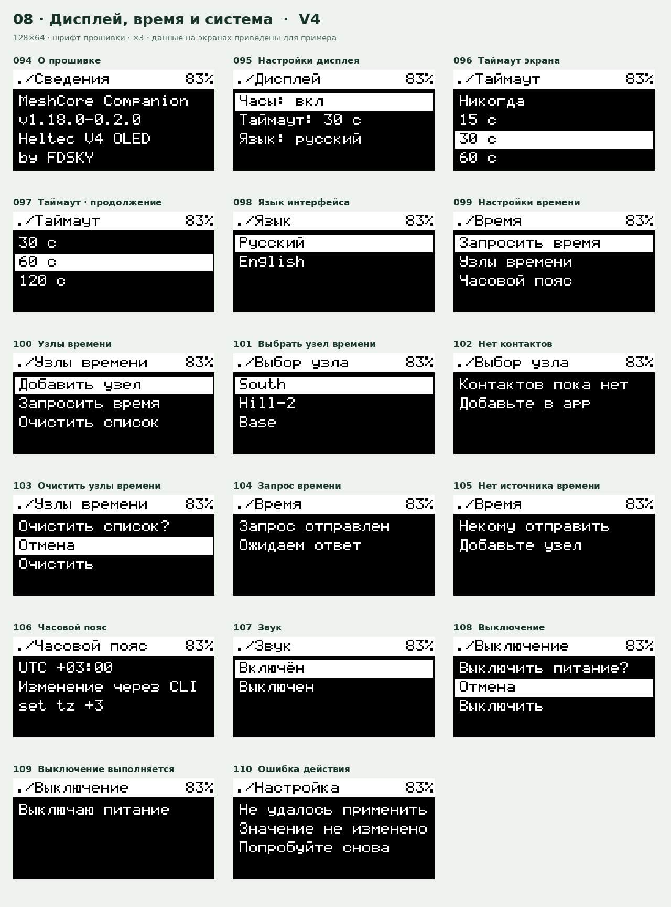
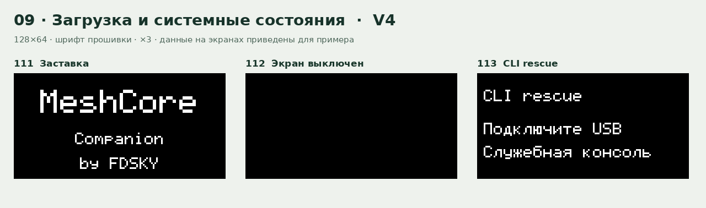

# Heltec V4 companion · интерфейс V4

Это **новая версия макетов интерфейса**, а не снимки реального устройства и не готовая прошивка. Все значения приведены для примера. Нарисовано 113 экранов и состояний в разрешении 128×64 с использованием шрифта из исходников; отдельные изображения также увеличены ×4 без сглаживания.

[Отдельные PNG ×4](png-4x/) · [Скачать все экраны: PNG 128×64 и ×4](screens-v4.zip) · [Каталог экранов и пояснения](screens.json) · [Сценарий построения макетов](render.py)

## Основной круг

Информационные страницы доступны сразу и образуют круг. Экран настроек — последний пункт круга; радио, GPS, маяк, частоты и недавние объявления доступны сразу. Страницы «Питание» и «Батарея» размещены в настройках; «Сведения» — последним пунктом настроек.

| Порядок | Экран | Что показывает |
|---:|---|---|
| 1 | Главная | Подключение, очередь, локальная память, дата |
| 2 | Сообщения | Счётчики и непрочитанные |
| 3 | Связь | BLE, Wi-Fi, USB и IP |
| 4 | Сеть | Соседи и SNR |
| 5 | Радио | Частота, BW/SF/CR/TX, NF и история |
| 6 | GPS | Спутники, высота, скорость, координаты |
| 7 | Маяк | Получатель, интервал, GPS и последняя отправка |
| 8 | Частоты | Текущая частота, поиск и его результаты |
| 9 | Недавние | Последние объявления |
| 10 | Шум | RSSI, NF, пик и приём пакета |
| 11 | Датчики | Доступные показания датчиков |
| 12 | Настройки | Вход в настройки всех функций |

GPS, маяк, датчики и звук показываются с учётом возможностей сборки и оборудования. Порядок экрана и кнопочные жесты являются предложением V4; для работающей прошивки потребуется реализация.

## Управление одной кнопкой

| Где | Один клик `•` | Два клика `••` | Удержание `━` |
|---|---|---|---|
| Основной круг | Следующая страница | Предыдущая страница | Открыть действия или соответствующий раздел настроек |
| Список и меню | Вниз на следующий доступный пункт | Вверх; с первого доступного пункта — на уровень назад | Открыть пункт / подтвердить выбор |
| Окно с данными | Следующая страница данных, если она есть | Предыдущая страница; с первой — назад | Открыть действия, если они есть |
| Окно подтверждения | Следующий вариант | Предыдущий вариант; с первого — отмена | Подтвердить выделенный вариант |
| Ввод цифр ADC | Увеличить текущую цифру | Уменьшить текущую цифру | Следующая цифра, затем подтверждение |

Списки не зацикливаются: на последнем пункте один клик остаётся на нём. Заголовки списков и текст вопроса не считаются пунктами. Для возврата достаточно подняться на первый пункт и нажать дважды; у опасных действий «Отмена» выделена сначала. В редакторе ADC выход без записи доступен на экране подтверждения, также надо предусмотреть возврат к исправлению цифр.

В основном круге удержание открывает: сообщения — список сообщений; связь — настройки интерфейсов; сеть — действия сети; радио, GPS и маяк — соответствующий раздел настроек; частоты — подтверждение поиска; недавние — действия объявления; шум — действия с пиком; датчики — обновление; настройки — главное меню. На главной удержание открывает сообщения.

Во вложенных разделах в заголовке показано `./Название`, без отдельной стрелки. Вложенность в заголовке обозначает текущий раздел, а фактический возврат идёт на непосредственно предыдущий экран. На корневых экранах в шапке также расположены время и заряд в процентах, без значка батареи. Если время или заряд неизвестны, отображаются прочерки.

Четыре клика возвращают на главную с любого открытого экрана. Незавершённое подтверждение отменяется, а поиск частоты прекращается с восстановлением настроек радио.

Длинный текст сообщения: `•` — следующая часть, `••` — предыдущая часть, а с первой — возврат к списку; удержание открывает действия. Входящие сохраняются в истории OLED без всплывающего просмотра и без пробуждения дисплея. Просмотр и удаление локальной копии не меняют очередь клиента. Первый законченный жест на погашенном дисплее только включает экран. Вход в CLI rescue при загрузке сохраняется.

## Пояснения к радио и GPS

На радио сохранена композиция примера WhisperOS: частота крупно, под ней одна рамка с BW/SF/CR/TX, внизу NF и небольшая история. Для `heltec_v4_oled_companion_usb_ble_wifi` экран и история NF обновляются раз в 500 мс, цикл калибровки приёмника также запрашивается раз в 500 мс без сканирования. Оценка усредняется по 64 допустимым отсчётам вне приёма пакета, поэтому в занятом эфире может обновляться реже; до первого значения показывается `NF --`. Историю нужно сбрасывать при смене радиопараметров, чтобы не смешивать измерения с разных настроек. NF — уровень шума, а не RSSI соседа. Значение TX берётся из настроек прошивки; мощность на выходе с учётом усилителя нельзя выводить как измеренную без соответствующих данных.

На GPS расположение следует образцу: число спутников и шкала сверху, высота и скорость следующей строкой, ниже широта и долгота. Шкала показывает количество спутников по фиксированной шкале 0–12, а не точность или качество сигнала. Без фикса координаты и высота заменяются прочерками. **Текущий `LocationProvider` скорости не предоставляет**, поэтому на макете стоит `--.-`; для живого значения нужно добавить его в источник GPS, а при отсутствии данных сохранять прочерк.

При поиске частоты приём временно прерывается. После завершения или отмены радио возвращается на исходные настройки; найденная частота автоматически не применяется. LNA FEM показывается только при поддержке платой и отдельно от встроенного RX Boost. Процент батареи — оценка по измеренному напряжению; калибровка ADC не означает измерения фактической ёмкости.

Меню, профили, предупреждения, ввод цифр и отдельные варианты состояний в каталоге — целевой дизайн. Некоторые из них потребуют изменений логики; сам набор макетов не меняет исходники прошивки. Фактическое отображение, скорость, поведение кнопки и сохранение данных необходимо будет проверить на Heltec V4.

## Все экраны

### 01 · Основной круг

### 02 · Состояния основных окон

### 03 · Сообщения и сеть

### 04 · Настройки и радио

### 05 · Связь и питание

### 06 · Аккумулятор и ADC

### 07 · GPS, маяк и частоты

### 08 · Дисплей, время и система

### 09 · Загрузка и служебные состояния

[Пиксельный аудит и проверка на устройстве](PIXEL-AUDIT.md).
